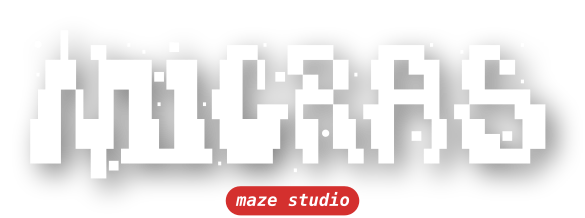
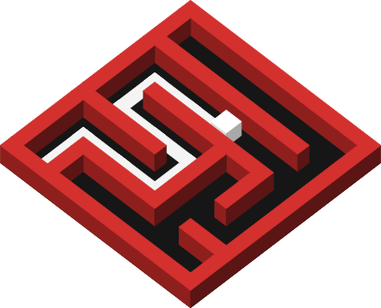
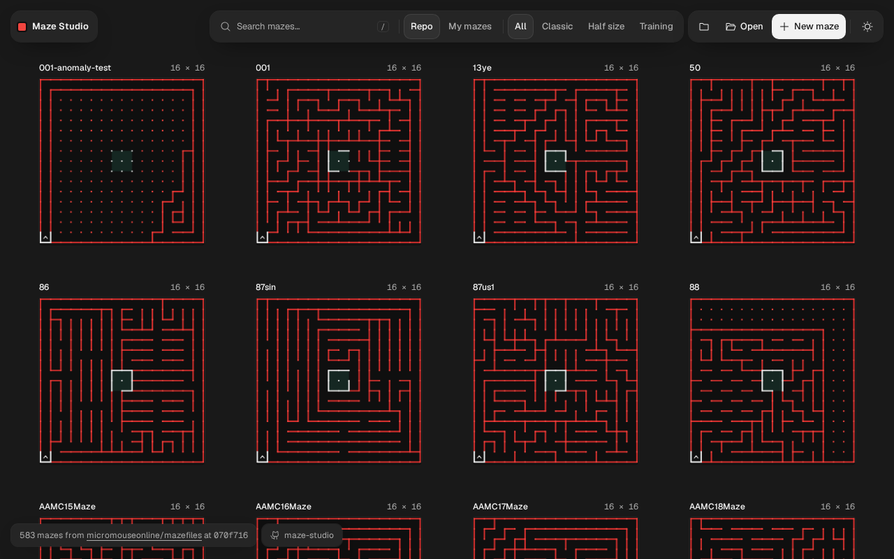
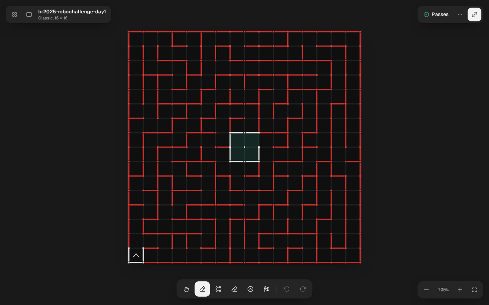
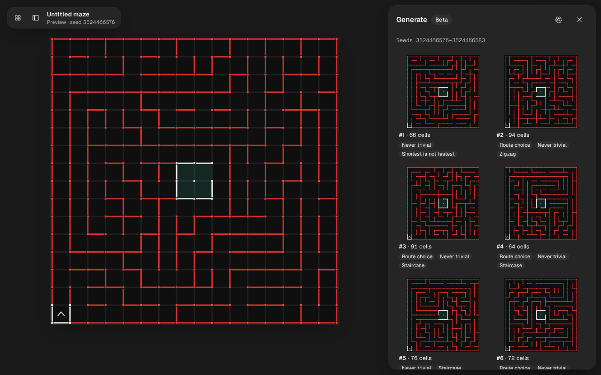

<!-- markdownlint-disable -->
<!-- prettier-ignore-start -->
<div align="center">



<p></p>

Micromouse mazes in the browser: browse, edit, generate and share, also offline

</div>

<div align="center">
  <a href="https://www.typescriptlang.org/"></a>
  <a href="https://github.com/micromouseonline/mazefiles"></a>
  <a href="https://en.wikipedia.org/wiki/Micromouse"></a>
</div>
<!-- prettier-ignore-end -->
<!-- markdownlint-restore -->

maze-studio is a web app for micromouse mazes in the text format of
[micromouseonline/mazefiles](https://github.com/micromouseonline/mazefiles). Open it at
[maze.micras.team](https://maze.micras.team) on a laptop or a phone, install it as an app, and take
it to a competition with no network.

<!-- markdownlint-disable -->
<!-- prettier-ignore-start -->
<div align="center">
  
</div>
<!-- prettier-ignore-end -->
<!-- markdownlint-restore -->

## 📑 Summary

- [📑 Summary](#-summary)
- [🧩 Features](#-features)
- [🔗 Embedding](#-embedding)
- [📁 Folder structure](#-folder-structure)
- [🚀 Running](#-running)
- [🧪 Testing](#-testing)
- [💄 Code style](#-code-style)
- [🌐 Deploying](#-deploying)
  - [🔄 Maze updates](#-maze-updates)
  - [🔧 Set up](#-set-up)
- [👥 Contributing](#-contributing)
  - [💬 Git commit messages](#-git-commit-messages)
  - [🔀 Git workflow](#-git-workflow)
- [🙏 Credit and license](#-credit-and-license)
- [✨ Contributors](#-contributors)

## 🧩 Features

- **Library**: every maze of the mazefiles repository on one canvas, with search and filters by
  source (Repo or My mazes) and category. Drag to pan; zoom with the wheel, a pinch or `+`/`-`.
- **Viewer**: walls, posts, start and goal drawn like the real track, checked against the classic
  rules ("Passes", or what is wrong and where).
- **Editor**: walls by drag or click, rectangles, clear area, start and goal, undo and redo, and a
  keyboard cell cursor. New maze comes in classic, half-size, training or a custom size. Your first
  edit of a repository maze copies it to **My mazes**, saved in the browser as you go. The Changes
  chip lists the session's edits, to keep or discard.
- **Generator (beta)**: New maze → Generate… builds a batch of 8 competition-style mazes from a
  preset tuned on real finals, with every target configurable. The maze keeps the recipe that made
  it.
- **Sharing and files**: Copy link puts the maze in the URL; Share… opens the phone's share sheet.
  Export downloads or copies the mazefile (`.txt`) or an SVG of the board. Open reads a `.txt`;
  Export all and Import move My mazes as a zip.
- **Offline**: after the first visit the app opens, searches, edits and saves with no network. It
  shows "New version." with Reload when one is out, and checks GitHub for new mazes once a day and
  on Check for updates.

The service worker and installation need `https://` or `localhost`.

<!-- markdownlint-disable -->
<!-- prettier-ignore-start -->
<div align="center">
  
  
</div>
<!-- prettier-ignore-end -->
<!-- markdownlint-restore -->

## 🔗 Embedding

Show one maze on another site with an iframe. The frame shows the maze alone with a link that opens
it in maze-studio, and leaves wheel and touch to the page around it.

```html
<iframe
  src="https://maze.micras.team/?embed#/repo/classic/br2025-robochallenge-day1.txt"
  title="Maze of RoboChallenge Brasil 2025, day 1"
  loading="lazy"
  style="width: 100%; aspect-ratio: 4 / 3; border: 0"
></iframe>
```

- `?embed` turns the embed on, whatever its value. Inside any frame maze-studio shows the embed
  anyway, so no site can frame the editor.
- `theme=light` or `theme=dark` sets the theme. Without it the frame follows the visitor's system
  theme.
- The hash picks the maze: `#/repo/<path>` for a repository maze, or `#/m/<code>` for a Copy link.
  The embed cannot show My mazes, since they live in the visitor's own browser, and says so.

To switch the theme without a reload, wait for `{ type: 'maze-studio:ready' }` from the frame and
post the theme on it and on every change. The frame takes the message only from its parent page,
and stops following the system theme once it gets one.

```js
const frame = document.querySelector('iframe');
const sendTheme = (theme) =>
  frame.contentWindow.postMessage({ type: 'maze-studio:theme', theme }, 'https://maze.micras.team');
window.addEventListener('message', (event) => {
  if (event.source === frame.contentWindow && event.data?.type === 'maze-studio:ready') {
    sendTheme(document.documentElement.classList.contains('dark') ? 'dark' : 'light');
  }
});
```

A sandboxed frame needs
`sandbox="allow-scripts allow-same-origin allow-popups allow-popups-to-escape-sandbox"` for "Open in
maze-studio" to work.

## 📁 Folder structure

- **.github/** - CI, deploy and preview workflows, the mazefiles auto-merge and Dependabot.
- **docs/** - Images for this README.
- **public/** - Icons and static files.
- **scripts/** - Bun scripts: the maze snapshot, the icons, the bundle size.
- **src/** - The app: maze core, library, renderer, generator and React UI.
- **sw/** - The service worker that serves the app offline.
- **tests/** - Tests mirroring `src/`, with the end-to-end tests in `tests/e2e/`.
- **vendor/mazefiles/** - The mazefiles repository as a submodule.

[`ARCHITECTURE.md`](ARCHITECTURE.md) maps the layers of `src/`,
[`decisions.md`](decisions.md) records why each choice was made, and [`AGENTS.md`](AGENTS.md) holds
the working rules.

## 🚀 Running

You need [Bun](https://bun.sh) 1.4 and Node.js 22.12 or later.

```sh
git clone --recurse-submodules https://github.com/Team-Micras/maze-studio.git
cd maze-studio
bun install
bun run dev
```

In a clone without `--recurse-submodules`, run `git submodule update --init` once.

| Script             | What it does                                                          |
| ------------------ | --------------------------------------------------------------------- |
| `bun run dev`      | Development server                                                    |
| `bun run build`    | Typecheck and build into `dist/`; `BASE_PATH` sets a base besides `/` |
| `bun run preview`  | Serve the build                                                       |
| `bun run size`     | Gzip size of the build                                                |
| `bun run snapshot` | Write `src/library/snapshot.json` from `vendor/mazefiles`             |

The snapshot is generated, not committed: `dev`, `build`, `lint`, `typecheck` and the tests write it
first when it is missing or stale.

## 🧪 Testing

The browser tests need Chromium: `bunx playwright install chromium`.

| Script                     | What it does                                                 |
| -------------------------- | ------------------------------------------------------------ |
| `bun run test`             | Unit tests (Node) and browser tests (Chromium)               |
| `bun run test:unit`        | Unit tests only                                              |
| `bun run test:browser`     | Browser tests only                                           |
| `bun run test:performance` | Frame-time tests, one file at a time, outside the check      |
| `bun run test:e2e`         | Build the app and drive it: PWA, offline, library, editor    |
| `bun run check`            | Lint, format, typecheck, tests, e2e, build and size, like CI |

CI runs the steps of `bun run check` as parallel jobs on every pull request; its `check` job passes
when all of them do. Reference screenshots come from the pinned Playwright Docker image;
[`AGENTS.md`](AGENTS.md) has the command to update them.

## 💄 Code style

[oxlint](https://oxc.rs/docs/guide/usage/linter) lints and
[oxfmt](https://oxc.rs/docs/guide/usage/formatter) formats the code and the Markdown, configured in
`.oxlintrc.json` and `.oxfmtrc.json`.

```sh
bun run lint
bun run format:check
bun run format
```

Write code and docs in English, with doc comments on exported APIs and no comments inside function
bodies.

## 🌐 Deploying

`pages.yml` publishes `main` to [maze.micras.team](https://maze.micras.team) on every push and on
demand from the Actions tab. The site lives in the Cloudflare Pages project `maze-studio`.

Each pull request from a branch of this repository gets a preview at
`https://pr-<number>.maze-studio-8ol.pages.dev/`, linked in a comment and updated on every push.
`preview-build.yml` builds it with no secrets, and `preview-deploy.yml`, from the default branch,
uploads the files without running them. Pull requests from forks get CI but no preview. Each preview
is its own origin, with its own My mazes and service worker.

### 🔄 Maze updates

The submodule `vendor/mazefiles` pins a commit of
[micromouseonline/mazefiles](https://github.com/micromouseonline/mazefiles), and the library comes
from it (`git submodule status vendor/mazefiles` prints it). Every week Dependabot opens two pull
requests that move it to the newest `master`: one to `main`, so new mazes reach the site without a
release, and one to `develop`.

`mazefiles-auto-merge.yml` turns on auto-merge for a Dependabot pull request that only changes the
submodule, so it lands once CI passes. The workflow waits for the required checks and merges nothing
if the base branch requires none. A merge by its `GITHUB_TOKEN` starts no other workflow, so after a
bump lands on `main` it starts `pages.yml` itself.

A release merges cleanly over the bumps, since both sides hold the same gitlink. If one of the two
bumps failed and `develop` sits a commit behind `main`, the release conflicts on
`vendor/mazefiles`: keep the newer commit.

### 🔧 Set up

- **Cloudflare**: a Pages project `maze-studio` with production branch `main` and the domain
  `maze.micras.team`. Save a token with only Account, Cloudflare Pages, Edit as the secret
  `CLOUDFLARE_API_TOKEN` of an environment `cloudflare` that only `main` can deploy from; a
  repository secret would reach every branch's `pull_request` runs. The account id sits in the
  deploy workflows.
- **Rules** for `main` and `develop` that require CI's `check` job.
- **Allow auto-merge** (Settings, General, Pull Requests), for the mazefiles bumps.

## 👥 Contributing

Follow the guidelines below and the rules in [`AGENTS.md`](AGENTS.md).

### 💬 Git commit messages

- Write one line: a gitmoji and a short English sentence, with no body.
- Use the present tense and the imperative mood ("Add the SVG export", not "Added the SVG export").
- Pick the emoji that fits the change, for example:
  - ✨ `:sparkles:` for new features.
  - 🐛 `:bug:` for bug fixes.
  - 🚑 `:ambulance:` for hotfixes.
  - ♻️ `:recycle:` for refactors.
  - ⚡ `:zap:` for performance.
  - 💄 `:lipstick:` for the look of the UI.
  - 📝 `:memo:` for documentation.
  - 👷 `:construction_worker:` for CI.

  For more examples, see [gitmoji.dev](https://gitmoji.dev/).

### 🔀 Git workflow

The project follows gitflow:

- Branch `feature/<name>` off `develop` and open a pull request back to `develop`. `bun run check`
  must pass, and the pull request gets its own preview.
- A release is a pull request from `develop` to `main`; merging it publishes
  [maze.micras.team](https://maze.micras.team).
- Branch `hotfix/<name>` off `main`.

## 🙏 Credit and license

The mazes come from [micromouseonline/mazefiles](https://github.com/micromouseonline/mazefiles),
gathered over many years by micromouseonline and its contributors, and belong to them. Report a
wrong maze upstream, as an issue on that repository. The code is under the [MIT license](LICENSE).

## ✨ Contributors

Thanks goes to these wonderful people ([emoji key](https://allcontributors.org/docs/en/emoji-key)):

<!-- ALL-CONTRIBUTORS-LIST:START - Do not remove or modify this section -->
<!-- prettier-ignore-start -->
<!-- markdownlint-disable -->
<table>
  <tr>
    <td align="center"><a href="https://github.com/PedroDeSanti"><br/><sub><b>Pedro de Santi</b></sub></a><br/><a href="https://github.com/Team-Micras/maze-studio/commits?author=PedroDeSanti" title="Code">💻</a> <a href="https://github.com/Team-Micras/maze-studio/commits?author=PedroDeSanti" title="Documentation">📖</a> <a href="#design-PedroDeSanti" title="Design">🎨</a> <a href="https://github.com/Team-Micras/maze-studio/commits?author=PedroDeSanti" title="Tests">⚠️</a> <a href="#infra-PedroDeSanti" title="Infrastructure (Hosting, Build-Tools, etc)">🚇</a></td>
    <td align="center"><a href="https://github.com/Eduardo-Barreto"><br/><sub><b>Eduardo Barreto</b></sub></a><br/><a href="https://github.com/Team-Micras/maze-studio/commits?author=Eduardo-Barreto" title="Code">💻</a> <a href="https://github.com/Team-Micras/maze-studio/commits?author=Eduardo-Barreto" title="Documentation">📖</a></td>
  </tr>
</table>

<!-- markdownlint-restore -->
<!-- prettier-ignore-end -->

<!-- ALL-CONTRIBUTORS-LIST:END -->

This project follows the [all-contributors](https://github.com/all-contributors/all-contributors) specification. Contributions of any kind welcome!
