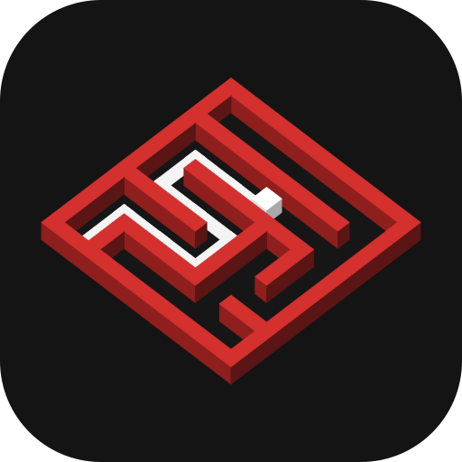

<!-- markdownlint-disable -->
<!-- prettier-ignore-start -->
<div align="center">



# maze-studio

Browse, view, edit, generate and share micromouse mazes, in the browser and offline

**[maze.micras.team](https://maze.micras.team)**

</div>

<div align="center">
  <a href="https://www.typescriptlang.org/"></a>
  <a href="https://react.dev/"></a>
  <a href="https://vite-pwa-org.netlify.app/"></a>
  <a href="https://pages.cloudflare.com/"></a>
</div>

<div align="center">
  
  
</div>
<!-- prettier-ignore-end -->
<!-- markdownlint-restore -->

maze-studio is a web app for the micromouse community. It works with mazes in the text format of
[micromouseonline/mazefiles](https://github.com/micromouseonline/mazefiles). It runs in the browser
on a laptop or a phone, installs as an app, and works offline at a competition.

## 📑 Summary

- [📑 Summary](#-summary)
- [🧩 Features](#-features)
- [🔗 Embedding](#-embedding)
- [📁 Folder structure](#-folder-structure)
- [🧰 Requirements](#-requirements)
- [🚀 Running](#-running)
- [🧪 Testing](#-testing)
- [💄 Code style](#-code-style)
- [🔄 Keeping the mazes up to date](#-keeping-the-mazes-up-to-date)
- [🌐 Deploying](#-deploying)
  - [🔧 Set up](#-set-up)
- [👥 Contributing](#-contributing)
  - [💬 Git commit messages](#-git-commit-messages)
  - [🔀 Git workflow](#-git-workflow)
- [🙏 Credit](#-credit)
- [📄 License](#-license)
- [✨ Contributors](#-contributors)

## 🧩 Features

- **Library.** Every maze of the mazefiles repository on one canvas, with thumbnails, search, and
  filters by source (Repo or My mazes) and category. Pan with a drag, zoom with the wheel, a pinch
  or `+`/`-`.
- **Viewer.** Opening a maze flies into it and draws it like the real track: walls, posts, start and
  goal, with checks against the classic rules ("Passes", or what is wrong and where).
- **Editor.** Walls by drag or click, rectangles, clear area, start and goal, with undo and redo, a
  cell cursor on the keyboard, and New maze in the classic, half-size and training sizes or a custom
  one. The first edit of a repository maze makes a copy in **My mazes**, kept in the browser and
  saved as you go. The Changes chip lists what changed in the session, to discard or keep.
- **Generator (beta).** New maze → Generate… makes competition-style mazes: a preset tuned on real
  finals, every target configurable, and a batch of 8 candidates to pick from. The maze keeps the
  recipe that made it.
- **Sharing and files.** Copy link (the maze in the URL), Share… on a phone, and Export (a submenu,
  or a group that opens in place on a phone): Download mazefile (.txt), Copy mazefile (.txt),
  Download SVG and Copy SVG (the board as an image for a README or a pull request). Open reads a
  `.txt`; Export all and Import move My mazes as a zip.
- **Offline and installable.** After the first visit the app opens, searches, edits and saves with
  no network. It installs as an app, says "New version." with Reload when there is one, and checks
  GitHub for newer mazes once a day and on Check for updates.

The service worker and installation need a secure context: `https://` or `localhost`.

## 🔗 Embedding

Another site can show one maze in a frame: the maze alone, fitted to the frame, with a small link
that opens it in maze-studio. The frame takes no wheel or touch, so the page around it scrolls as
usual.

```html
<iframe
  src="https://maze.micras.team/?embed#/repo/classic/br2025-robochallenge-day1.txt"
  title="Maze of RoboChallenge Brasil 2025, day 1"
  loading="lazy"
  style="width: 100%; aspect-ratio: 4 / 3; border: 0"
></iframe>
```

- `embed` in the query turns the embed on; its value does not matter. Inside any frame maze-studio
  is always the embed, with or without it, so a frame made without `?embed` still works and no site
  can frame the editor itself.
- `theme=light` or `theme=dark` sets the theme. Without it the frame follows the visitor's system
  theme, also when it changes.
- The hash picks the maze: `#/repo/<path>` for a maze of the repository, as maze-studio has it
  built in, or `#/m/<code>` for a link made by Copy link. My mazes live in the visitor's own browser,
  so the embed does not show them, and says so.

The page around the frame can set its theme without reloading it, for example when the page has a
theme switch of its own. The frame posts `{ type: 'maze-studio:ready' }` to the page once it
listens; send the theme on `maze-studio:ready` and whenever it changes:

```js
const frame = document.querySelector('iframe');
const sendTheme = (theme) =>
  frame.contentWindow.postMessage({ type: 'maze-studio:theme', theme }, 'https://maze.micras.team');
window.addEventListener('message', (event) => {
  if (event.source === frame.contentWindow && event.data?.type === 'maze-studio:ready') {
    sendTheme(document.documentElement.classList.contains('dark') ? 'dark' : 'light');
  }
});
```

The frame takes the theme message only from the page that holds it, with `theme` either `light` or
`dark`. Once it has one, it no longer follows the system theme.

For a frame with a `sandbox` attribute, use
`sandbox="allow-scripts allow-same-origin allow-popups allow-popups-to-escape-sandbox"`; the two
popup flags let "Open in maze-studio" open.

## 📁 Folder structure

- **.github/** - CI, the deploy and preview workflows, the mazefiles auto-merge and Dependabot.
- **docs/** - Images for this README.
- **public/** - Icons and static files served as they are.
- **scripts/** - Bun tools: the snapshot, the icons, the bundle size report.
- **src/** - The app: the maze core, the library, the renderer, the generator and the React UI.
- **sw/** - The service worker that precaches the build and serves it offline.
- **tests/** - Tests, mirroring `src/`, and the end-to-end tests in `tests/e2e/`.
- **vendor/mazefiles/** - The mazefiles repository as a submodule.

[`ARCHITECTURE.md`](ARCHITECTURE.md) explains the layers of `src/` and what may import what; start
there to understand the code. [`decisions.md`](decisions.md) records why each choice was made, and
[`AGENTS.md`](AGENTS.md) holds the working rules for the repository.

## 🧰 Requirements

- [Bun](https://bun.sh) 1.4 (package manager and scripts)
- Node.js 22.12 or later (Vite and Vitest run on it)
- Playwright's Chromium for the browser tests: `bunx playwright install chromium`

## 🚀 Running

```sh
git clone --recurse-submodules https://github.com/Team-Micras/maze-studio.git
cd maze-studio
bun install
bun run dev
```

In a clone made without `--recurse-submodules`, run `git submodule update --init` once.

| Script             | What it does                                                               |
| ------------------ | -------------------------------------------------------------------------- |
| `bun run dev`      | Development server                                                         |
| `bun run build`    | Typecheck and build into `dist/`; `BASE_PATH` sets a base other than `/`   |
| `bun run preview`  | Serve the built app                                                        |
| `bun run size`     | Gzip size of the build, after `bun run build`                              |
| `bun run snapshot` | Write `src/library/snapshot.json` from `vendor/mazefiles`; runs on its own |

`src/library/snapshot.json` is generated, not committed: `dev`, `build`, `lint`, `typecheck` and
the test scripts write it from the submodule first, when it is missing or of another commit.

## 🧪 Testing

| Script                     | What it does                                                            |
| -------------------------- | ----------------------------------------------------------------------- |
| `bun run test`             | Unit tests (Node) and browser tests (Chromium)                          |
| `bun run test:unit`        | Unit tests only                                                         |
| `bun run test:browser`     | Browser tests only                                                      |
| `bun run test:performance` | Frame-time tests in Chromium, one file at a time, outside the check     |
| `bun run test:e2e`         | Builds the app and drives it in Chromium: PWA, offline, library, editor |
| `bun run check`            | Lint, format, typecheck, tests, e2e, build and size: what CI runs       |

CI runs the steps of `bun run check` as parallel jobs on every pull request, and its `check` job
passes when all of them do.

The reference screenshots in `tests/**/screenshots/` come from the Playwright image of the pinned
version, so they match CI and not one notebook. [`AGENTS.md`](AGENTS.md) has the command to update
them.

## 💄 Code style

[oxlint](https://oxc.rs/docs/guide/usage/linter) lints and [oxfmt](https://oxc.rs/docs/guide/usage/formatter)
formats the code and the Markdown, with the settings in `.oxlintrc.json` and `.oxfmtrc.json`.

```sh
bun run lint
bun run format:check
bun run format
```

Code and docs are in English, with doc comments on exported APIs and no comments inside function
bodies.

## 🔄 Keeping the mazes up to date

maze-studio pins [micromouseonline/mazefiles](https://github.com/micromouseonline/mazefiles) as the
submodule `vendor/mazefiles` and builds its library from that commit;
`git submodule status vendor/mazefiles` prints it.

Dependabot (`.github/dependabot.yml`) opens two pull requests every week that move
`vendor/mazefiles` to the newest commit of `master`: one against `main`, so new mazes reach the site
without a release, and the same one against `develop`. The workflow `mazefiles-auto-merge.yml` turns
on auto-merge for a Dependabot pull request that changes nothing but the submodule, so it lands once
CI passes, with no one involved. For that, the GitHub repository needs:

- **Allow auto-merge**, in Settings, General, Pull Requests;
- a rule for `main` and one for `develop` (branch protection or a ruleset) that require the
  `check` job of CI to pass before merging.

The workflow also waits for those required checks itself and fails, merging nothing, when the base
branch requires none. Without auto-merge, the pull request waits for a person. A merge made with
the workflow's `GITHUB_TOKEN` starts no other workflow, so once a bump lands on `main` the workflow
starts `pages.yml` itself, by `workflow_dispatch`.

The two bumps never get in the way of a release: a merge compares content, and the same gitlink on
both sides is no conflict. The one exception is `develop` a bump behind `main`, after one of the two
pull requests failed. The release then conflicts on `vendor/mazefiles`; keep the newer commit.

## 🌐 Deploying

`pages.yml` publishes `main` to <https://maze.micras.team> on every push to it and on demand from
the Actions tab.

Every pull request from a branch of this repository gets a preview at
`https://pr-<number>.maze-studio-8ol.pages.dev/`, linked in a comment and updated on every push. A
pull request from a fork gets CI but no preview, since a preview publishes its code under the
project's domain. The site and the previews are deployments of one Cloudflare Pages project,
`maze-studio`: `main` is production, at `maze.micras.team`, and each pull request a branch
`pr-<number>`. `preview-build.yml` builds the pull request with no write access and no secret, and
`preview-deploy.yml`, which runs as it is on the default branch, uploads the built files and never
runs them. Each preview is an origin of its own, so it keeps its own My mazes and service worker,
and nothing of the site's.

### 🔧 Set up

- **Cloudflare**, once: a Pages project `maze-studio` with production branch `main` and the custom
  domain `maze.micras.team`, and a token with only Account, Cloudflare Pages, Edit, saved as the
  secret `CLOUDFLARE_API_TOKEN` of an environment `cloudflare` that only `main` may deploy from. A
  repository secret would reach the `pull_request` runs of every branch. The account id is in the
  deploy workflows.
- **Rules** for `main` and `develop` that require the `check` job of CI.
- **Allow auto-merge**, for the weekly mazefiles bumps.

## 👥 Contributing

To contribute, follow the guidelines below and the rules in [`AGENTS.md`](AGENTS.md).

### 💬 Git commit messages

- Write one line: a gitmoji and a short English sentence, with no body.
- Use the present tense and the imperative mood ("Add the SVG export", not "Added the SVG export").
- Pick the emoji that fits the change, for example:
  - ✨ `:sparkles:` for new features.
  - 🐛 `:bug:` for bug fixes.
  - 🚑 `:ambulance:` for hotfixes.
  - ♻️ `:recycle:` for refactors.
  - ⚡ `:zap:` for performance.
  - 💄 `:lipstick:` for the look of the UI.
  - 📝 `:memo:` for documentation.
  - 👷 `:construction_worker:` for CI.

  For more examples, see [gitmoji.dev](https://gitmoji.dev/).

### 🔀 Git workflow

The repository follows gitflow:

- Start a `feature/<name>` branch from `develop` and open a pull request back to `develop`.
  `bun run check` must pass, and the pull request gets its own preview on Cloudflare Pages.
- A release is a pull request from `develop` to `main`. Merging it publishes
  [maze.micras.team](https://maze.micras.team).
- A `hotfix/<name>` branch starts from `main`.

## 🙏 Credit

The mazes come from [micromouseonline/mazefiles](https://github.com/micromouseonline/mazefiles),
a collection of micromouse maze files gathered over many years from many sources by
micromouseonline and its contributors. Corrections to a maze belong upstream, as an issue on that
repository.

## 📄 License

The code is under the [MIT license](LICENSE). The mazes belong to the mazefiles repository and its
contributors.

## ✨ Contributors

Thanks goes to these wonderful people ([emoji key](https://allcontributors.org/docs/en/emoji-key)):

<!-- ALL-CONTRIBUTORS-LIST:START - Do not remove or modify this section -->
<!-- prettier-ignore-start -->
<!-- markdownlint-disable -->
<table>
  <tr>
    <td align="center"><a href="https://github.com/PedroDeSanti"><br/><sub><b>Pedro de Santi</b></sub></a><br/><a href="https://github.com/Team-Micras/maze-studio/commits?author=PedroDeSanti" title="Code">💻</a> <a href="https://github.com/Team-Micras/maze-studio/commits?author=PedroDeSanti" title="Documentation">📖</a> <a href="#design-PedroDeSanti" title="Design">🎨</a> <a href="https://github.com/Team-Micras/maze-studio/commits?author=PedroDeSanti" title="Tests">⚠️</a> <a href="#infra-PedroDeSanti" title="Infrastructure (Hosting, Build-Tools, etc)">🚇</a></td>
    <td align="center"><a href="https://github.com/Eduardo-Barreto"><br/><sub><b>Eduardo Barreto</b></sub></a><br/><a href="https://github.com/Team-Micras/maze-studio/commits?author=Eduardo-Barreto" title="Code">💻</a> <a href="https://github.com/Team-Micras/maze-studio/commits?author=Eduardo-Barreto" title="Documentation">📖</a></td>
  </tr>
</table>

<!-- markdownlint-restore -->
<!-- prettier-ignore-end -->

<!-- ALL-CONTRIBUTORS-LIST:END -->

This project follows the [all-contributors](https://github.com/all-contributors/all-contributors) specification. Contributions of any kind welcome!
